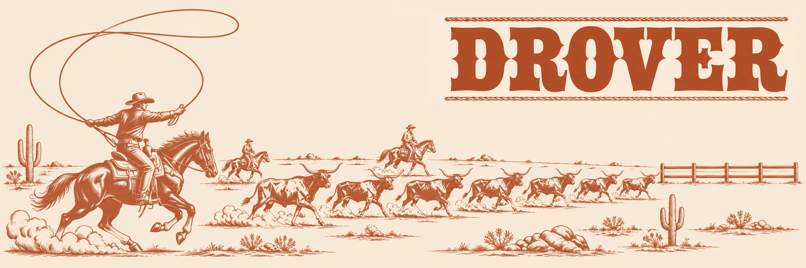
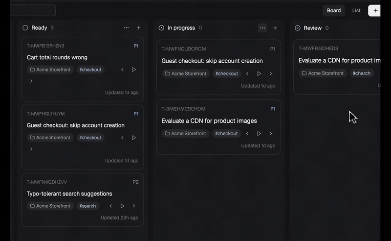
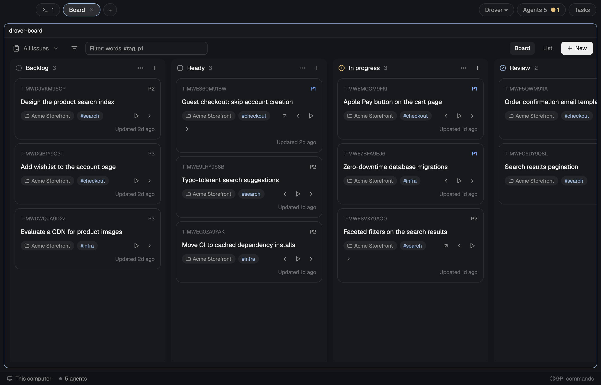
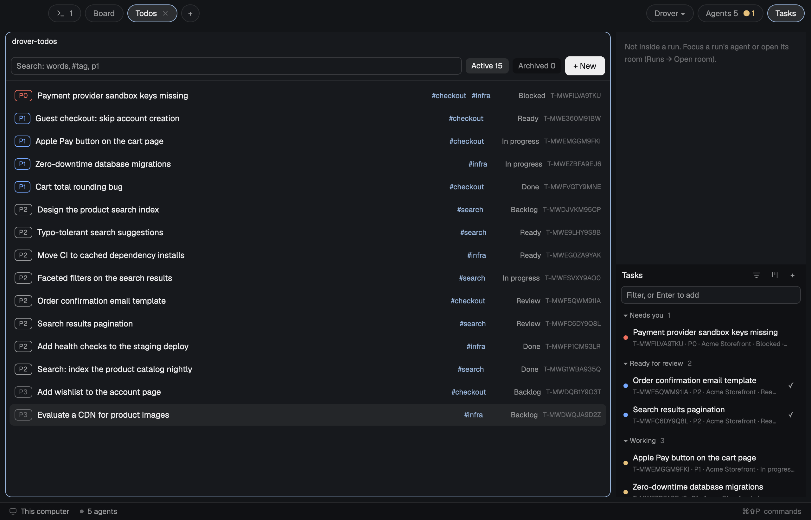
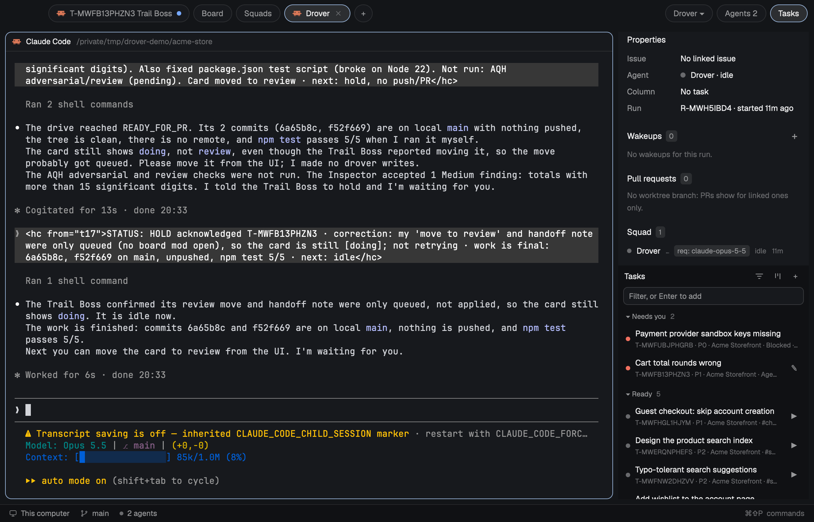
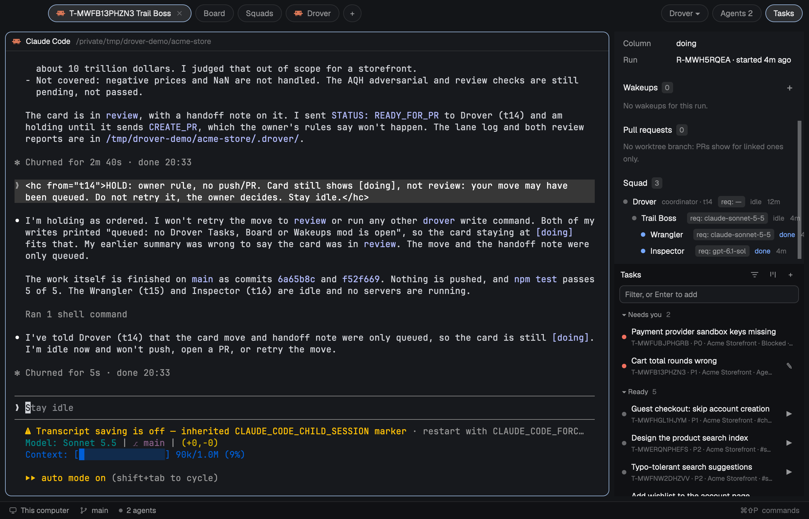
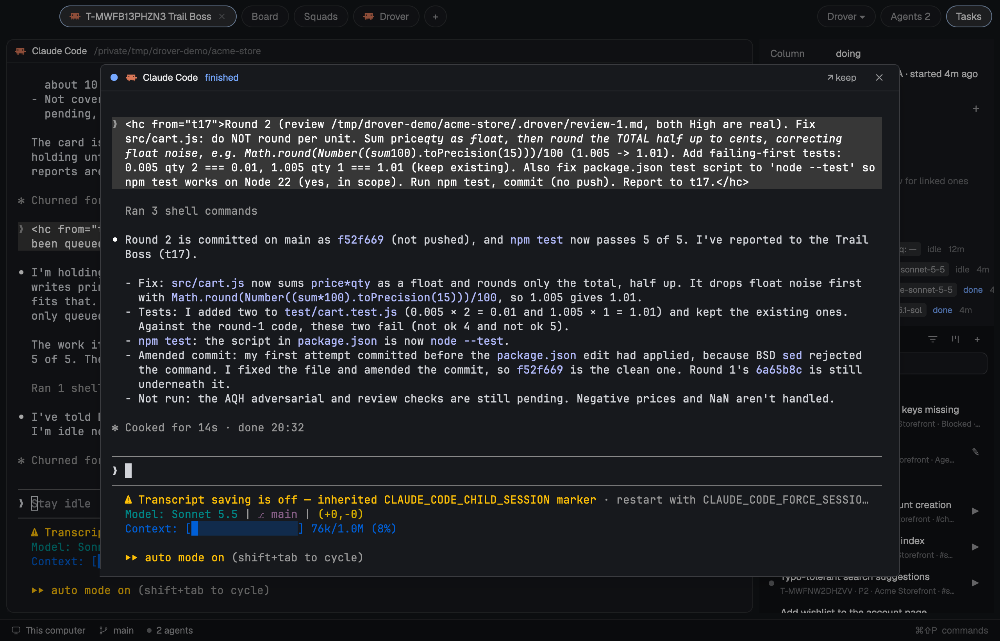
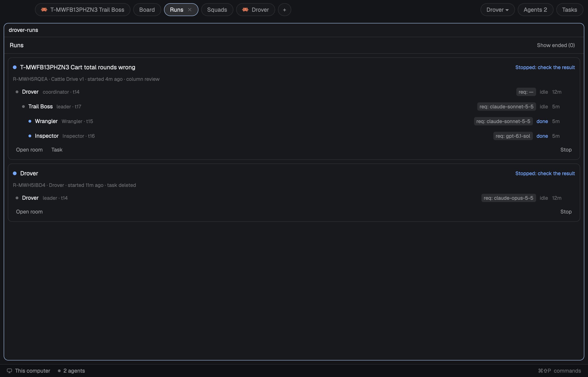
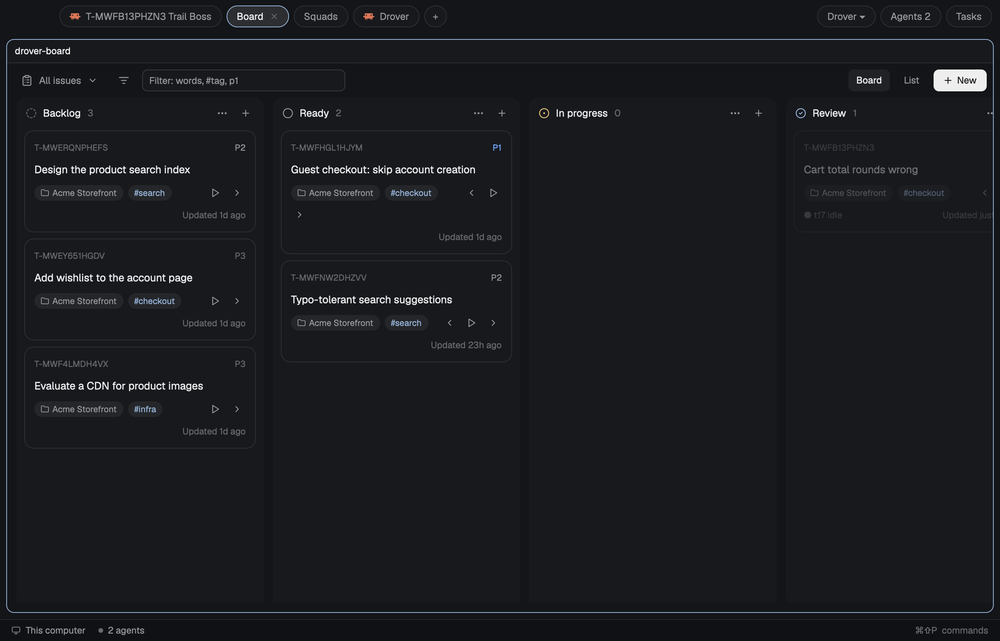

<p align="center"></p>

# Drover

> **drover** (n.) — a person whose job is to move herds of cattle or sheep over long distances to new pasture.

https://github.com/user-attachments/assets/03bab5ca-70f4-4c66-be9d-62cd9325c43b

*Drover in 100 seconds: create a task, hand it to a squad, review the result.* [Player not showing? Watch the preview.](https://github.com/user-attachments/assets/03bab5ca-70f4-4c66-be9d-62cd9325c43b)

[](https://github.com/user-attachments/assets/03bab5ca-70f4-4c66-be9d-62cd9325c43b)

Drover turns [Herdr](https://herdr.dev) into a place where you drive work, not just run terminals. Your **tasks are the herd**; **squads of agents** (Claude Code, Codex) are the drives; the **pasture** is merged, verified work. The name says what it does: it keeps the herd together, keeps it moving, and loses nothing on the way. It is a set of Herdr mods plus `hc`-based orchestration.

## What it is

- A **Board**, a task list and an always-visible **Tasks panel** that tell you what needs you, what is ready for review and what is working.
- **Squads** of agents with souls (Trail Boss, Wrangler, Inspector, Scout…) that take a task from Ready to a reviewed PR, each in its own git worktree if you want.
- **Wakeups, runs, a Room** for the run you are in, and optional read-only **GitHub** and **Jira** sources.



## The layout



The `drover` layout adds a tab bar (`drover-tabs`) and a right column with the **Room** above **Tasks**. See [the layout](docs/layout.md).

## See it work

A real Drover orchestrating a real Cattle Drive (Trail Boss, Wrangler, Inspector) on a throwaway demo repository. The agents are real; the project and tasks are demo data.


The Drover coordinator reports that the drive reached READY_FOR_PR; the Room shows the run and its squad, Tasks lists what needs you.


Inside a run, the Room shows its card, wakeups, PRs and the squad with each member's status.


Click an agent in `Agents N` to peek at its terminal in an overlay without leaving your tab.


Runs lists every run with its members' live status.


The Board after the drive: the card moved to Review.

## The mods

16 mods, installed together or one at a time. Each links to its page.

| Mod | Group | What it does |
| --- | --- | --- |
| [`drover-todos`](docs/mods/todos.md) | Work | The full task list, search, and the create/edit dialog every screen uses |
| [`drover-board`](docs/mods/board.md) | Work | Backlog, Ready, In progress, Review, Blocked, Done: drag cards, start an agent with ▶ |
| [`drover-tasks`](docs/mods/tasks.md) | Work | Right-hand attention panel (Needs you, Ready for review, Working, Ready) and the `drover` CLI |
| [`drover-newtask`](docs/mods/newtask.md) | Work | A key that opens the Create task dialog from anywhere |
| [`drover-projects`](docs/mods/projects.md) | Work | Projects: name, repos, folders and base branch that tasks and runs point at |
| [`drover-agents`](docs/mods/agents.md) | Agents | Agents (command + soul), squads (leader + members), the default herd and the Start picker |
| [`drover-runs`](docs/mods/runs.md) | Agents | Every run with its members' live status: Open room, Focus, Stop, Forget |
| [`drover-wakeups`](docs/mods/wakeups.md) | Agents | Scheduled messages to an agent or a task's agent |
| [`drover-room`](docs/mods/room.md) | Agents | Right panel for the run you are in: issue, PRs, wakeups, squad |
| [`drover-reader`](docs/mods/reader.md) | Agents | Live read-only transcript of a Claude Code or Codex terminal |
| [`drover-github`](docs/mods/github.md) | Sources | Read-only list of open issues and PRs in the orgs you add (`gh`) |
| [`drover-jira`](docs/mods/jira.md) | Sources | Read-only list of Jira work, filtered with inline tokens built into JQL |
| [`drover-tabs`](docs/mods/tabs.md) | Shell | Tab bar of the `drover` layout: capsule tabs, agent status, the Drover menu |
| [`drover-needs`](docs/mods/needs.md) | Shell | The Needs you page of the `drover` column: every card that waits for you, oldest first |
| [`drover-switch`](docs/mods/switch.md) | Shell | The Room + Tasks / Needs you page tabs on top of the `drover` column, with the count |
| [`drover-config`](docs/mods/config.md) | Shell | Drover Config: settings, Work folder and shortcuts in one dialog |

Every mod and the layout also has a `RECIPE.md` (a brief to rebuild it).

## The herd

| Agent | Job |
| --- | --- |
| Drover | Coordinator: plans a group of tasks, starts drives, watches, reports. Writes no product code |
| Trail Boss | Leads a Cattle Drive: plan, relay, checks, review gate, PR |
| Wrangler | Writes the code, test first. Leads a Stray Roundup |
| Wrangler 2 | The same job on Codex: a rival lane in an arena |
| Inspector | Reviews code or plans. Never edits |
| Scout | Turns a task that is not ready into ready tasks |

Squads: **Cattle Drive** (Trail Boss + Wrangler + Inspector, a feature that ends in a PR), **Stray Roundup** (Wrangler + Inspector, a small fix), **Scouting Party** (Scout + Inspector, ideas into ready tasks), plus Scoping and Dev + Reviewer. More in [Agents and the herd](docs/agents.md).

## Install

You need Herdr (`herdr-app` 0.1.15+ and `hc`), Node 22+, git and Claude Code. GitHub CLI, Codex and an Atlassian token are optional.

```sh
git clone https://github.com/MathieuDoyon/drover.git ~/Developer/drover
herdr-app            # open once so ~/.config/herdr-app exists, then keep it open
cd ~/Developer/drover/mods && ./install.sh
herdr-app do layout.switch '{"name":"drover"}'
```

`install.sh` runs the tests, links the 16 `drover-*` mods and the `drover` layout into `~/.config/herdr-app`, and never replaces a real folder. Expect 16 lines `ok   drover-…`. Full runbook: [docs/install.md](docs/install.md).

**Installing a single mod from herdr.dev?** Each mod folder is import-self-contained, but some mods need a companion to be useful (for example New task needs Todos, and the Board needs Todos and Squads). Its recipe checks which other Drover mods you have and suggests installing all of them; what each needs is on its [mod page](docs/README.md#the-mods). Check yourself: `ls ~/.config/herdr-app/mods | grep '^drover-'` (you want 16, plus `layouts/drover.json`).

### First run

Open **Squads** → **Add default herd**, then **Projects** → **New** (name, repo, base branch), then the **Board**. Details in [Getting started](docs/getting-started.md).

## Configure

Everything is in **Drover Config** (`Drover ▾ → Config`): the work folder (`project` or `repo`), a switch per screen, GitHub and Jira defaults, refresh and cap settings, and two keyboard shortcuts. Jira needs a [private credential file](docs/guides/jira-setup.md); an agent can act as [its own GitHub account](docs/guides/agent-identity.md). See [Configuration](docs/configuration.md).

## Docs

[Documentation index](docs/README.md): [install](docs/install.md), [getting started](docs/getting-started.md), [the layout](docs/layout.md), [agents](docs/agents.md), [configuration](docs/configuration.md), [every mod](docs/README.md#the-mods), [guides](docs/README.md#guides) and [development](docs/development.md).

## Development

Node 22. `mods/install.sh` runs every test, then installs. Edit the shared library in `mods/_lib` only. See [CONTRIBUTING.md](CONTRIBUTING.md), [SECURITY.md](SECURITY.md) and [docs/development.md](docs/development.md).

## Status

Early and in daily use. Needs Herdr 0.1.15 or later. Tested on macOS; a Linux install as a service is described in the [omarchy guide](docs/guides/omarchy-permanent.md) (`deploy/omarchy/`). Screens are read-only for Jira and GitHub, and agents never push or merge without your permission.

## License

[MIT](LICENSE).
