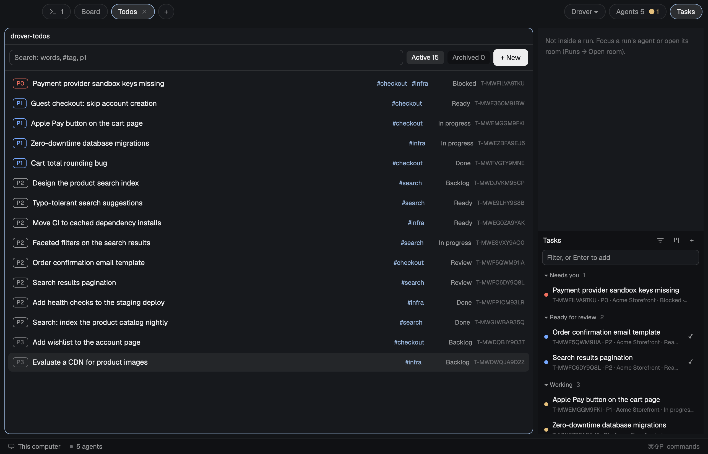

# The drover layout



`mods/_layouts/drover.json` is a Herdr layout: your usual window plus a Drover tab bar and a right column.

```text
+------------+-----------------------------------------+-----------+
| sidebar    |  tabs  (drover-tabs, 42px)              |           |
| 268px      +-----------------------------+-----------+  drover   |
| spaces     |                             | (panel,   |  column   |
| agents     |   main (the active tab)     |  hidden)  |  300px    |
|            |                             |           |  Room     |
|            |                             |           |  Tasks    |
+------------+-----------------------------+-----------+-----------+
| status bar (28px)                                                |
+------------------------------------------------------------------+
```

- **Tab bar** (`drover-tabs`): capsule tabs with agent status, `Agents N ● blocked ● working` (click to go to an agent), `Drover ▾` (open a screen as a tab, split the current pane with it, or open a two-screen tab: Sources = Jira | GitHub, Squads = Agents | Runs, Work = Board | Tasks) and `Tasks`.
- **Right column** (`drover`, 300px): the Room (the run you are in) above Tasks (what needs you). The `Tasks` capsule, or `cmd-alt-b`, shows and hides it.
- **Left sidebar**: Herdr's own spaces and agents lists (`ctrl-shift-b` toggles it; below 160px it becomes a rail).
- A hidden 368px `panel` (files and changes) sits between the tab area and the right column: unhide it in `drover.json`.

## Switch

```sh
herdr-app do layout.switch '{"name":"drover"}'   # back: '{"name":"main"}', or ctrl-shift-l
```

`install.sh` links the layout into `~/.config/herdr-app/layouts/drover.json` (only if that is not a real file). The layout needs `drover-tabs`, `drover-room` and `drover-tasks`; keep the column id `drover` or the Tasks toggle does nothing.

Rebuild it from [`mods/_layouts/RECIPE.md`](../mods/_layouts/RECIPE.md).
