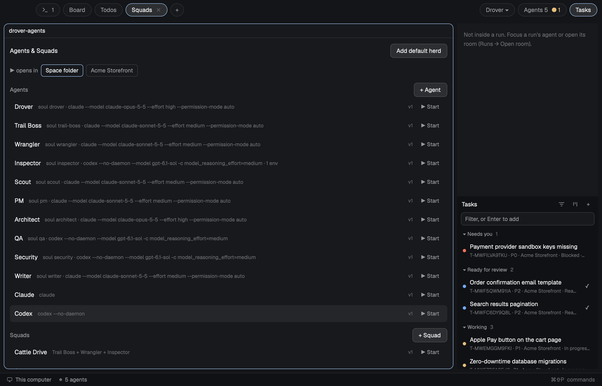

# Agents & Squads

`drover-agents`. Your agents (a command plus a soul and instructions) and squads (a leader and members with roles), the default herd, and the Start picker with its optional git worktree and report-to-Drover choices.

## Open it

`herdr-app do tab.new --name Squads --mod drover-agents`, or `Drover ▾ → Squads`.

## Settings

Change them in Drover Config (see [Configuration](../configuration.md)).

| Setting | Meaning |
| --- | --- |
| `enabled` | Drover Config → `enabled` (on by default). Off hides the screen and blanks it; the data and the `drover` CLI stay. |
| `default_squad` | Empty. A squad id the Start picker selects when nothing was used before. |
| `default_worktree` | Off. Start the picker with Own git worktree ticked. |
| `default_report` | Off. Start the picker with Report to Drover ticked (needs a running Drover). |

## Data it reads and writes

Reads and writes `drover.agents` (profiles and squads, versioned on save) and `drover.agents.last`; reads `drover.projects`. Agent environment values are written to a private file; shared state keeps only the names.

## Needs

`hc` and the agent CLIs you configure (`claude`, `codex`). Reads its own `souls/` folder.

Works alone: Yes for defining agents. Starting them from a card needs `drover-todos`, Board or Tasks to open the picker.

## Limits

Other screens open this mod's picker as a dialog: without it their ▶ buttons open nothing. Copy the mod with its `souls/` folder, or agents start without a soul. See [Agents and the herd](../agents.md).

## Rebuild it

[`RECIPE.md`](../../mods/drover-agents/RECIPE.md) is the brief another agent can build this mod from. Back to the [mods index](../README.md#the-mods).
