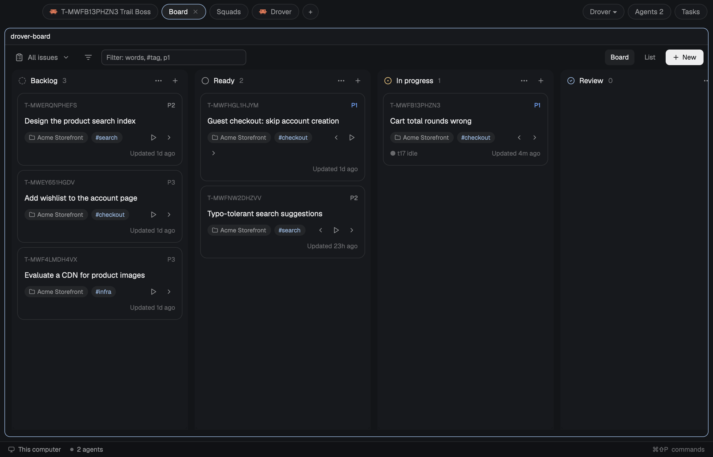

# Board

`drover-board`. A Trello-like board: Backlog, Ready, In progress, Review, Blocked and Done, with drag and drop, a List view, a scope menu (All issues, With agent, No agent, P0-P1), filters, and a one-click ▶ to start an agent or squad on a card.

## Open it

`herdr-app do tab.new --name Board --mod drover-board`, or `Drover ▾ → Board`.

## Settings

Change them in Drover Config (see [Configuration](../configuration.md)).

| Setting | Meaning |
| --- | --- |
| `enabled` | Drover Config → `enabled` (on by default). Off hides the screen and blanks it; the data and the `drover` CLI stay. |
| `visible_columns` | All 6. The columns the board and its list show (at least one). Hiding is screen only: the tasks and the `drover` CLI keep all six. |
| `default_sort` | `manual`. How each column sorts (`manual`, `priority`, `newest`). A column's own Sort menu wins while the board is open. |

## Data it reads and writes

Reads and writes `drover.tasks`; reads `drover.projects`, `drover.runs`, `drover.agents`. Applies the `drover` CLI inbox (`<home>/data/drover-inbox`) even when its screen is off.

## Needs

`drover-todos` (card editor and New), `drover-agents` (the ▶ picker).

Works alone: Shows cards, drags and moves them without the others; edit and start do nothing without them.

## Limits

Keys work after you click the board: arrows, shift+←/→ to move, enter to edit, `n` new, `s` start. The Done column offers an archive with a confirm step. A card with a live agent shows its status; a gone terminal shows only when nothing is saved.

## Rebuild it

[`RECIPE.md`](../../mods/drover-board/RECIPE.md) is the brief another agent can build this mod from. Back to the [mods index](../README.md#the-mods).
