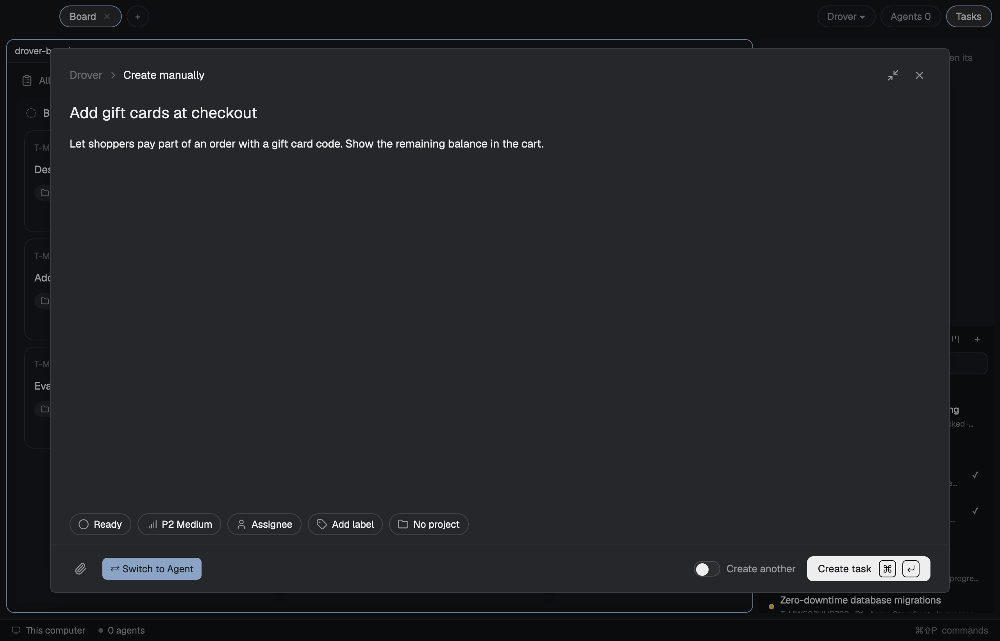

# New task

`drover-newtask`. No screen: a key that opens the Create task dialog from anywhere.

## Open it

Press `cmd-shift-c` once the shortcut is on (Drover Config → Shortcuts). It is bound in `keys.json` as `"cmd-shift-c": "mod.open:drover-newtask"` under `global`.

## Settings

Change them in Drover Config (see [Configuration](../configuration.md)).

| Setting | Meaning |
| --- | --- |
| `(none)` | It has no `enabled` switch. Turn the shortcut on or off in Drover Config → Shortcuts. |

## Data it reads and writes

Writes the guard `drover.newtask.open` in shared state.

## Needs

`drover-todos`: it opens that mod's Create dialog.

Works alone: No: without `drover-todos` the key does nothing.

## Limits

It never opens a second dialog while one Create dialog is open. The key is yours to change: Drover Config refuses to bind a combo that `keys.json` already uses elsewhere (free that key first) and never replaces it.

## Rebuild it

[`RECIPE.md`](../../mods/drover-newtask/RECIPE.md) is the brief another agent can build this mod from. Back to the [mods index](../README.md#the-mods).
