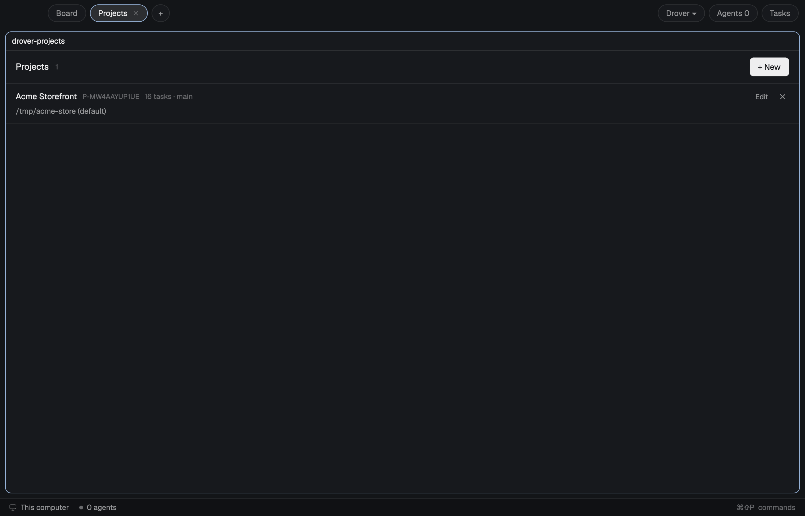

# Projects

`drover-projects`. The list of projects: a name, its repos (the first is the default), loose folders and the base branch. A task picks a project; starting with a worktree uses the project's default repo.

## Open it

`herdr-app do tab.new --name Projects --mod drover-projects`, or `Drover ▾ → Projects`.

## Settings

Change them in Drover Config (see [Configuration](../configuration.md)).

| Setting | Meaning |
| --- | --- |
| `enabled` | Drover Config → `enabled` (on by default). Off hides the screen and blanks it; the data and the `drover` CLI stay. |

## Data it reads and writes

Reads and writes `drover.projects`. Runs `git` on each repo path to check it.

## Needs

`git`.

Works alone: Yes.

## Limits

Repo paths must be git repositories. ✕ is refused while tasks use the project. Names are unique, case-insensitive.

## Rebuild it

[`RECIPE.md`](../../mods/drover-projects/RECIPE.md) is the brief another agent can build this mod from. Back to the [mods index](../README.md#the-mods).
