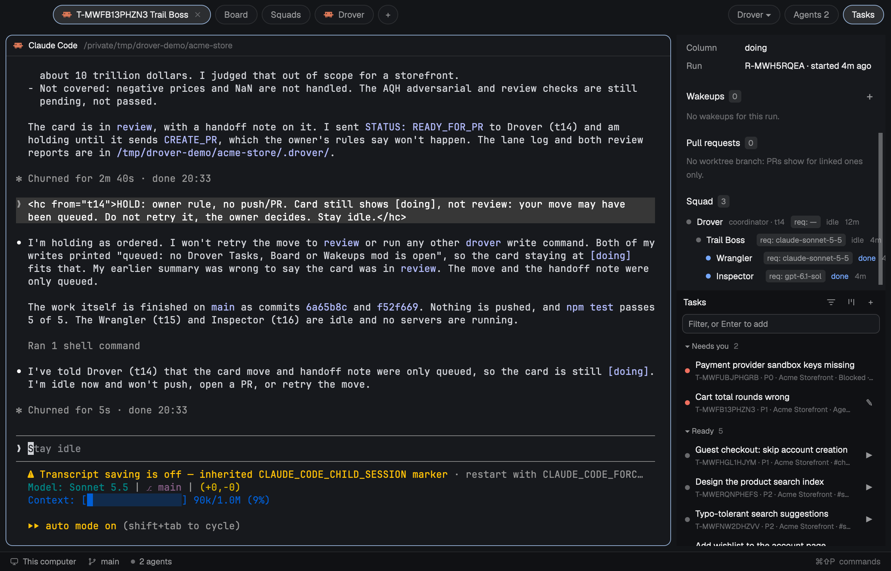

# Room

`drover-room`. The right panel for the run you are in: the linked issue's properties, agent, branch, the run's wakeups, parent issue, PRs on the branch and the squad.

## Open it

In the `drover` layout it is the top of the right column. As a bare pane it needs a block: `herdr-app do pane.split '{"direction":"right","mod":"drover-room"}'`.

## Resume a gone squad

When every terminal of the run you are in is gone and its card is not Done or archived, the Squad section shows **Resume squad**. A gone run you cannot select here (a squad without a worktree has no folder to match) has the same button in [Runs](runs.md). One click reopens the whole squad: members first (each is waited for until it reports an agent status twice and has received its first message), then the leader, whose first message holds the new address map and what changed. Members are parked again, as at launch. Before it saves anything it checks, on a terminal list that Herdr actually answered, that every reopened terminal is still there and not blocked; an unreadable list is retried a few times and then fails the resume (it is never taken as a pass).

- **Command.** Each agent reopens its saved session with the agent's **current** settings. If that attempt fails (blocked, exited, no first message), that terminal is killed and confirmed gone, and the same session is tried with the run's **frozen** command (same model and permission mode). Only if both fail does the whole resume fail. Resume adds only the resume flag: never a more permissive flag, never a new session id.
- **Worktree.** A worktree that is gone is recreated from the run's branch. It refuses, and says why, when the branch is gone, the folder is in the way or is not that worktree, the branch is checked out elsewhere, or the repo is gone.
- **One attempt per card.** The card is claimed while it runs. **Cancel** (here and in Runs, or `drover resume --cancel <R-…|T-…>`) stops it. The attempt also stops, without touching your choice, when the card is moved to any other column, goes Done, is archived or deleted, or its claim is replaced.
- **When it fails.** It kills only the terminals this attempt opened, releases the claim and leaves the old run as it was. If a kill cannot be confirmed, the claim and the attempt record stay on purpose, so a second squad is never opened next to a terminal that may still be alive; the failure says so, and the card then needs a manual **Recover** (below). A blocked terminal is never answered for you: a notice tells you.
- **After a crash: one manual Recover.** Nothing recovers by itself, and no timer kills or frees anything. If Herdr or the mod stops in the middle of a resume, the card stays claimed and the Squad section (and the run in [Runs](runs.md)) shows **Resume needs recovery** once the attempt has been silent for the claim time plus the barrier (about 6 minutes with the defaults), with two buttons. **Recover** adopts a squad the attempt had already saved (when the card is still in progress and not archived or moved), or else kills the terminals the attempt owns (found by the token in their first message) and releases the card. **Cancel** abandons it: it kills the same terminals, also removes a squad the attempt had saved, and releases the card. In both cases a card you moved, finished or archived meanwhile keeps your choice and is not re-staffed. Recover refuses while the resume is still running (cancel that instead) and while it is being recovered; if it cannot read the terminal list, cannot tell whose a terminal is or cannot confirm a kill, it changes nothing and can be pressed again. From a terminal: `drover resume <R-…> --recover` or `--cancel`. If a launch was in flight when the attempt stopped and no terminal is found, the answer says so: if one appears later, close it by hand.
- **Links.** The new run records `resumedFrom`; the old run stays in history with `resumedBy`, and the orphan reaper skips it.
- **CLI.** `drover resume <R-…|T-…> [--recover|--cancel]` (a card id resumes its newest run). A Drover without this version answers "Unknown drover command".
- **Not checked live:** a real `claude --resume` or `codex resume` run, and a resumed Claude that opens a summary dialog (that counts as blocked).

## Settings

Change them in Drover Config (see [Configuration](../configuration.md)).

| Setting | Meaning |
| --- | --- |
| `enabled` | Drover Config → `enabled` (on by default). Off hides the screen and blanks it; the data and the `drover` CLI stay. |
| `refresh_minutes` | 5 (1-1440). Minimum age before a run's context reloads. |
| `pr_cap` | 10 (1-100). Most PRs linked from the issue. |
| `kept_contexts` | 30 (1-1000). Runs whose context it remembers. |

## Data it reads and writes

Reads `drover.runs`, `drover.tasks`, `drover.wakeups`, `drover.projects`; writes its cache `drover.room` and wakeup toggles. Calls `gh` and the Jira API for the linked issue.

## Needs

`gh` and the Jira credential file for issue data; `drover-wakeups` (the `+` dialog) and `drover-todos` (edit).

Works alone: It opens alone and says "Not inside a run" until a run exists.

## Limits

Read-only for Jira and GitHub. It refreshes no faster than `refresh_minutes` per run and keeps the last good data on errors.

## Rebuild it

[`RECIPE.md`](../../mods/drover-room/RECIPE.md) is the brief another agent can build this mod from. Back to the [mods index](../README.md#the-mods).
