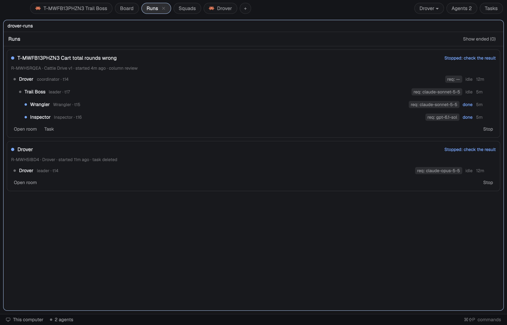

# Runs

`drover-runs`. Every agent or squad run with its members' live status, and Open room, Focus, Stop and Forget.



## Open it

`herdr-app do tab.new --name Runs --mod drover-runs`, or the Squads preset (`Drover ▾`), which shows Agents and Runs side by side.

## Settings

Change them in Drover Config (see [Configuration](../configuration.md)).

| Setting | Meaning |
| --- | --- |
| `enabled` | Drover Config → `enabled` (on by default). Off hides the screen and blanks it; the data and the `drover` CLI stay. |
| `max_parallel` | 2 (1-10). Squad runs active at once for each project. A run whose card is in Review or Blocked is "waiting": it stays alive but takes no slot, and takes one again when the card moves back. Set it in `Drover ▾ → Config` (Runs), or an agent can set it on your request: see [Parallel runs](#parallel-runs). |
| `kept` | 200 (10-5000). Ended runs remembered; a running run is never dropped. |

## Parallel runs

When a start is refused with `no free slot: limit N reached`, the limit is `drover-runs.max_parallel`. It is machine-wide, counts each project on its own, and applies at once (no restart). Lowering it never stops a run that is already going; it only refuses new starts.

A squad parked on a card in Review (waiting for a PR) or Blocked does not hold a slot. The refusal names them (`N waiting in Review/Blocked (not counted)`) and `drover next` prints `ok: N slots · W waiting`. When you move such a card back to In progress the move is never refused and no run is stopped: the run counts again, so a project can be over its limit (3 active with a limit of 2). Then new starts are refused and `drover next` reports 0 slots until a run ends or another card moves to Review or Blocked. A manual or CLI start and Resume are owner actions and do not check the limit (only a bound Drover's start does). A card that is archived or missing does not free its run's slot.

You can raise it in `Drover ▾ → Config → Runs → Parallel runs`, or ask an agent to. The agent runs, in its terminal:

```
drover config                    # the settings an agent may change, with the value in force
drover config max-parallel       # show
drover config max-parallel 4     # set (1-10)
```

This is the only setting an agent can change, and the rule for agents is to do it only when you ask, in plain text in its own terminal, never to unblock itself. Each change shows a notice with the terminal that asked (the terminal is what the caller claims; it is not verified). `drover config` needs Drover mods at protocol 5: with older mods it says to update them, and with no Drover mod open it changes nothing. A change that gets no answer within 5 seconds is reported as not confirmed, and the request expires after 60 seconds.

## Live line

A working run can say what it is doing. In a terminal of the run, `drover line <T-…> "reading the code" --progress 40` (the text is 40 characters at most, the progress a whole number from 0 to 100 and optional) stores a line on the run, and the run card shows one extra row under the id line: `reading the code · 40% · 3m` (the elapsed time is whole minutes, `<1m` under one). The same line shows on the card's row in the Working group of [Tasks](tasks.md). Leaders post one at each STATUS (the herd rules in [Agents and the herd](../agents.md)).

- A line older than 10 minutes is dimmed. It is gone when the run ends (a run that ends while the screen is open loses it at the next second; the record drops it when the end is saved). A new line replaces the old one; one without `--progress` drops the old percentage.
- There is no time-left estimate.
- The command checks the text before it sends anything: too long, a newline or control character, a bad progress, a secret-shaped text or a home folder path is refused with the rule name and nothing is written. The secret scan is best effort (the same rules as the herd export): never put a value in a line.
- Which terminal may post is checked against the runs (a terminal of an active run of that card). The terminal is what the caller claims, as for `drover note`: it guards against mistakes on this machine, not against someone who can already write to your Drover inbox.
- A request that waits more than 5 minutes with no Drover mod open expires instead of showing late. An older Drover mod (not reloaded) answers `Unknown drover command`: reopen the window after an install.

The screen draws from a cache that is refreshed when it starts, every second and after its own actions; drawing it reads memory only.

## Data it reads and writes

Reads and writes `drover.runs` (the live line is `line` on a run, dropped when the run is marked ended).

## Resume squad

An ended run whose card is not Done or archived has **Resume squad**; while an attempt runs it shows **Cancel resume**; after a crash it shows **Resume needs recovery** with **Recover** and **Cancel** (nothing recovers by itself). What it does, and when it refuses, is on the [Room page](room.md#resume-a-gone-squad). A resumed run keeps its history: the old run has `resumedBy` and is not touched by the orphan reaper.

## Needs

`drover-agents` or Board/Tasks start the runs it lists.

Works alone: It opens fine alone and stays empty until a run exists.

## Limits

Stop takes two clicks and kills the run's terminals; worktrees are never removed. A stopped agent shows "stopped: check the result", never "done".

## Rebuild it

[`RECIPE.md`](../../mods/drover-runs/RECIPE.md) is the brief another agent can build this mod from. Back to the [mods index](../README.md#the-mods).
