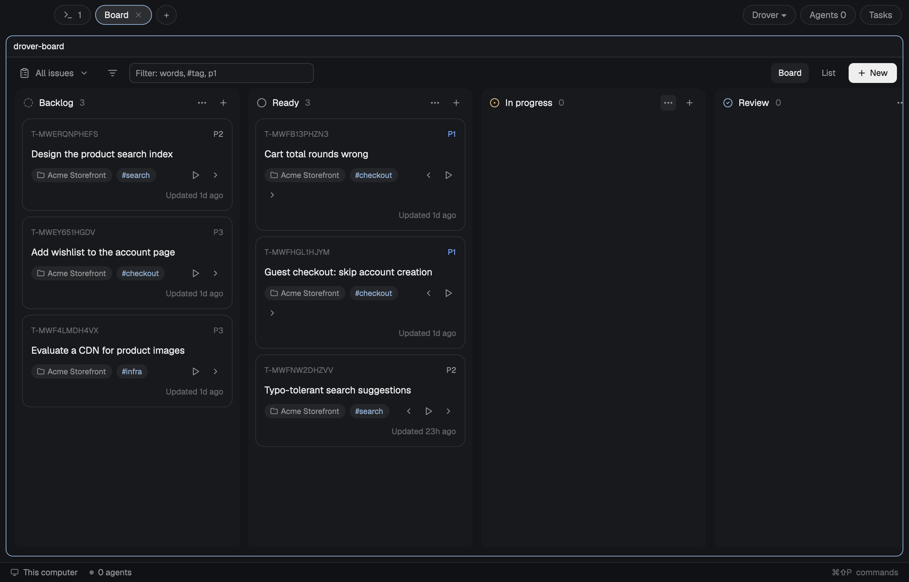

# Drover Tabs

`drover-tabs`. The tab bar of the `drover` layout: capsule tabs with agent status, the `Agents N` selector, the `Drover ▾` menu (open a screen, split, or open a two-screen preset) and the Tasks toggle.

## Open it

Only through the `drover` layout: `herdr-app do layout.switch '{"name":"drover"}'`.

## Settings

Change them in Drover Config (see [Configuration](../configuration.md)).

| Setting | Meaning |
| --- | --- |
| `(none)` | No `enabled` switch. The `cmd-alt-b` shortcut (section `layout:drover`) toggles the right column; set it in Drover Config → Shortcuts. |

## Data it reads and writes

Reads `drover.runs` and the Herdr spaces, panes and agents; reads each screen's `enabled`.

## Needs

The shipped Herdr `menu` and `new-menu` mods. It opens every other Drover screen by name and `drover-config` for Settings.

Works alone: Only useful inside the `drover` layout.

## Limits

A screen is listed only when its `enabled` is on. A missing mod's entry opens an empty tab.

## Rebuild it

[`RECIPE.md`](../../mods/drover-tabs/RECIPE.md) is the brief another agent can build this mod from. Back to the [mods index](../README.md#the-mods).
