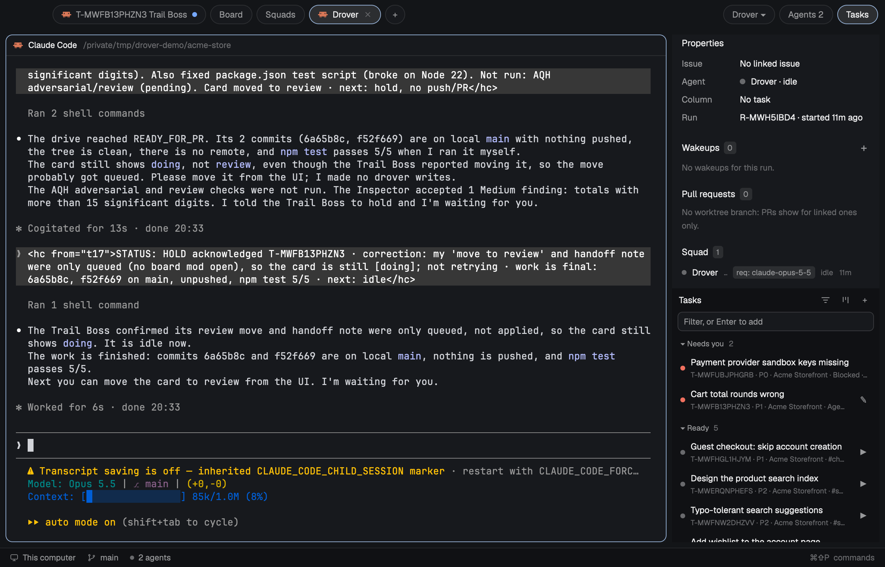

# Tasks

`drover-tasks`. The right-hand attention panel: one row per task grouped as Needs you, Ready for review, Working and Ready, with a filter box (Enter adds a task). It also holds the `drover` command-line tool agents use.

## Open it

In the `drover` layout it is the bottom of the right column. Alone: `herdr-app do pane.split '{"direction":"right","mod":"drover-tasks"}'`.

## Settings

Change them in Drover Config (see [Configuration](../configuration.md)).

| Setting | Meaning |
| --- | --- |
| `enabled` | Drover Config → `enabled` (on by default). Off hides the screen and blanks it; the data and the `drover` CLI stay. |

## Data it reads and writes

Reads and writes `drover.tasks`; filters are saved per space (`drover.tasks.filters`). `bin/drover` reads `<home>/shared.json` and writes requests to `<home>/data/drover-inbox`.

## Needs

`drover-todos` (editor), `drover-agents` (▶ picker). The CLI needs `bash`, `python3`, and `hc` for wakeups.

Works alone: Lists and filters tasks alone. Without an open Tasks, Board or Wakeups mod, CLI writes stay `queued`.

## Limits

A 300px right panel (`place: right`). The ✓ on a review row moves the card to Done. The filter menu never defaults to hiding anything. In a narrow pane the rows truncate.

## Rebuild it

[`RECIPE.md`](../../mods/drover-tasks/RECIPE.md) is the brief another agent can build this mod from. Back to the [mods index](../README.md#the-mods).
