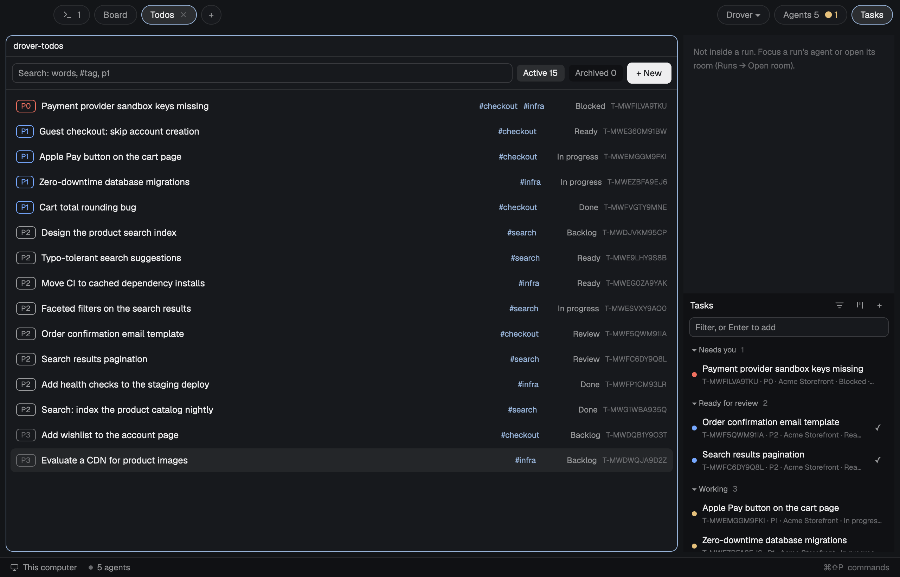

# Todos

`drover-todos`. The full task list with search, Active/Archived views, and the dialog every other Drover screen uses to create or edit a task (title, Markdown description, priority, column, tags, project, parent, assignee, linked issue, notes, run history).

## Open it

`herdr-app do tab.new --name Todos --mod drover-todos`, or `Drover ▾ → Todos`.

## Settings

Change them in Drover Config (see [Configuration](../configuration.md)).

| Setting | Meaning |
| --- | --- |
| `enabled` | Drover Config → `enabled` (on by default). Off hides the screen and blanks it; the data and the `drover` CLI stay. |
| `context_refresh_seconds` | 60 (5-3600). How often an open task reloads its run and PR context. Applies when the screen reopens. |
| `pr_cap` | 10. Most pull requests listed under a task. |
| `run_history_cap` | 10. Most past runs listed under a task. |
| `wake_cap` | 20. Most open and most ended wakeups listed under a task. |

## Data it reads and writes

Reads and writes `drover.tasks`; reads `drover.projects`, `drover.runs`, `drover.wakeups`; writes `drover.newtask.open` (a guard so two Create dialogs never stack). Pasted images are saved under the Herdr home.

## Needs

Nothing is required. The assignee menu lists the agents and squads saved by `drover-agents` (the built-in defaults when none are saved).

Works alone: Yes: list, search, create, edit.

## Limits

The editor opens as a dialog of this mod, so **every other screen that creates or edits a task needs `drover-todos`** (Board, Tasks, GitHub, Room, Runs and the New task key). Search is words, `#tag` and priority (`p1`); there is no saved search. The clipboard image paste uses `osascript` and works on macOS only.

## Rebuild it

[`RECIPE.md`](../../mods/drover-todos/RECIPE.md) is the brief another agent can build this mod from. Back to the [mods index](../README.md#the-mods).
