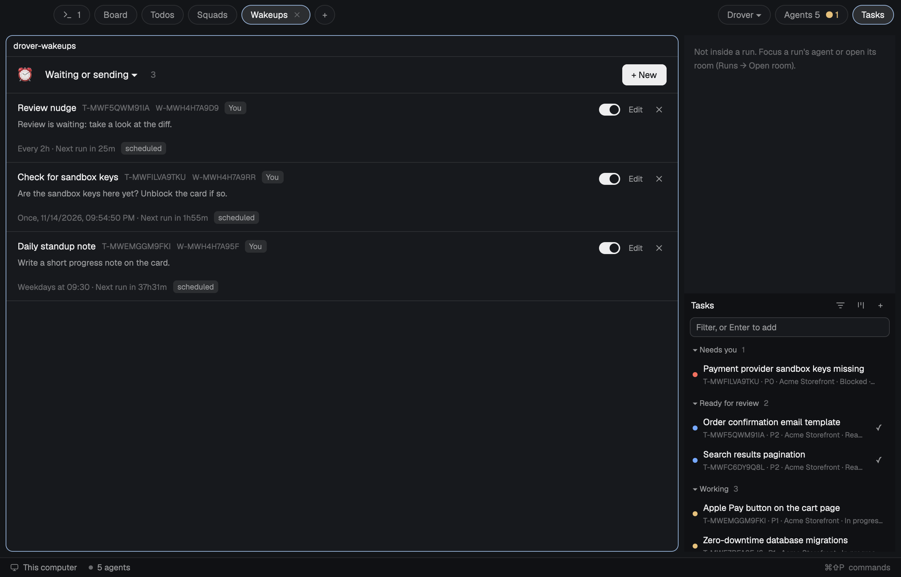

# Wakeups

`drover-wakeups`. A table of every scheduled message to an agent or a task's agent, with filters (Waiting or sending, Ended, All), add, edit and an enabled toggle.

## Open it

`herdr-app do tab.new --name Wakeups --mod drover-wakeups`, or `Drover ▾ → Wakeups`.

## Settings

Change them in Drover Config (see [Configuration](../configuration.md)).

| Setting | Meaning |
| --- | --- |
| `enabled` | Drover Config → `enabled` (on by default). Off hides the screen and blanks it; the data and the `drover` CLI stay. |
| `min_repeat_minutes` | 5 (1-1440). The shortest repeat; the `drover wake` CLI uses it too. |
| `expiry_hours` | 2 (1-168). A wakeup not delivered this long after its time expires. |
| `ui_tick_seconds` | 30 (1-3600). Countdown repaint. Applies when the screen reopens. |

## Data it reads and writes

Reads and writes `drover.wakeups`; delivers with `hc send`.

## Needs

`hc`. The New wakeup dialog of this mod is also opened by the Room's `+`.

Works alone: Yes.

## Limits

Delivery only to an idle or finished agent: busy and blocked wait, a gone terminal fails, 2 hours late expires, a failed send is never retried. Delivery runs while this mod or Tasks is open; with none open nothing is delivered.

## Rebuild it

[`RECIPE.md`](../../mods/drover-wakeups/RECIPE.md) is the brief another agent can build this mod from. Back to the [mods index](../README.md#the-mods).
