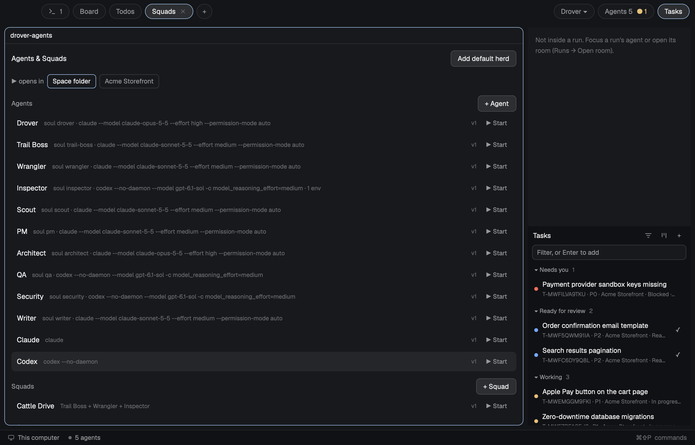

# Agents & Squads

The screen where you define your agents (a command and a soul) and your squads (a leader plus members), and the picker that starts them.

## What you see

A tab titled `Agents & Squads` with a header (an `▶ opens in` project selector, `Add default herd`, new agent, new squad), then two lists: agents (name, command, soul, env-variable count, ▶ Start) and squads (name, leader, members with roles, ▶ Start).
Editors are 520px dialogs. An agent has Name, Command (`claude --model claude-opus-5-5`), Instructions (a textarea, 6 rows) and Environment rows (a variable name, then `set` + Replace; values are masked and never shown). A squad has Name, a leader, and members with a role each.
The Start picker (460px wide, 75% tall) lists agents and squads, optionally with an own git worktree and space; with 2+ Drovers on screen it also lists them to choose which Drover to report to.

## How it behaves

- ▶ on an agent or squad starts it in a new tab with no task, in the chosen project's repo (else the space's folder).
- Profiles are versioned on save; saving an agent keeps the squads that use it. Deleting an agent removes its env file.
- Env values are written to a file through `io.js`; shared state keeps names only.
- `Add default herd` adds the built-in agents and squads that are missing, by id, and never changes yours.
- The picker remembers the last choice (`drover.agents.last`), else the Drover Config default.

## Built from

- Mod `drover-agents`, `place: none`, `main.js` (about 340 lines), `bin/` (the `drover-workfolder` and read-only `drover-lessons-read` helpers) and `souls/` (Markdown souls for the default herd plus `_herd.md`, the shared rules).
- `herdr` imports: `props`, `closeOverlay`, `openOverlay`, `theme`, `shared`, `setShared`, `notify`, `exec`, `appHome`, `hc`, `focused`.
- Programs it runs: `hc` (start terminals), the profile's own command (`claude`, `codex`), `open` (Open ↗).
- Default herd (`_lib/runs.js` `DEFAULT_AGENTS`, `DEFAULT_SQUADS`): Drover, Trail Boss, Wrangler, Wrangler 2, Inspector, Scout, PM, Architect, QA, Security, Writer, Claude, Codex; squads Cattle Drive, Stray Roundup, Scouting Party, Scoping, Dev + Reviewer.

## Watch out

- Shared state keys are named in `_lib/store.js` (`drover.tasks`, `drover.projects`), `_lib/wake.js` (`drover.wakeups`) and `_lib/runs.js` (`drover.agents`, `drover.runs`). `mods/install.sh` copies the `_lib` files listed in `_lib/copies.txt` next to `main.js`; a copy of the mod alone must carry them.
- Needs `hc` and the agent CLIs you configure on PATH. The souls are read from this mod's `souls/` folder: copy the mod with it or agents start without a soul.
- Pairs with `drover-runs` (the Squads preset tab shows both) and `bin/drover` from `drover-tasks` (agents report with it).
- Other screens open its picker as a dialog (`openOverlay({ mod: "drover-agents", props: { pick } })`); without this mod their ▶ buttons open nothing.
- Colors, borders and radii come from `theme()`; no hex value is hard coded. Every screen has an `enabled` switch in Drover Config (off hides the screen only; the data and the `drover` CLI stay).

## Companion mods

<!-- companions:begin -->
**Before you finish, check the companion mods.** Drover is 14 `drover-*` mods and one layout that work together. This mod is one of them.

1. List what is installed: `ls <home>/mods | grep '^drover-'` (`<home>` is the Herdr home, `~/.config/herdr-app` by default). Compare it with this list and work out which are missing:
   `drover-agents`, `drover-board`, `drover-config`, `drover-github`, `drover-jira`, `drover-newtask`, `drover-projects`, `drover-reader`, `drover-room`, `drover-runs`, `drover-tabs`, `drover-tasks`, `drover-todos`, `drover-wakeups`. Also check `<home>/layouts/drover.json`.
2. Tell the person plainly: "installed X of 14, missing [...]". Count this mod as installed once it is in place. If this is the only one, say so.
3. If any are missing, recommend installing all of them: clone `github.com/MathieuDoyon/drover`, then run `mods/install.sh` (it also links the `drover` layout). Or install them one by one from herdr.dev. Ask before installing anything.
4. Then ask once, in one message: Work folder location (project default or the repo's `.drover/`); enable GitHub (y/n); enable Jira (y/n); a shortcut for the right sidebar (Tasks) (y/n); a shortcut to create a task (y/n). Apply the answers in Drover Config (Work folder, the GitHub and Jira switches). The two shortcuts go into `keys.json` under `layout:drover` (`cmd-alt-b` runs `layout.toggle` for the `drover` column) and `global` (`cmd-shift-c` runs `mod.open:drover-newtask`); Drover Config → Shortcuts writes them. Ask before replacing a key the person already uses.
<!-- companions:end -->

## Done when

- `Add default herd` fills both lists; running it twice adds nothing.
- ▶ on `Stray Roundup` creates a run that shows in Runs.
- A saved env variable shows `set`, never its value.
- `herdr-app check` on the mod passes.
