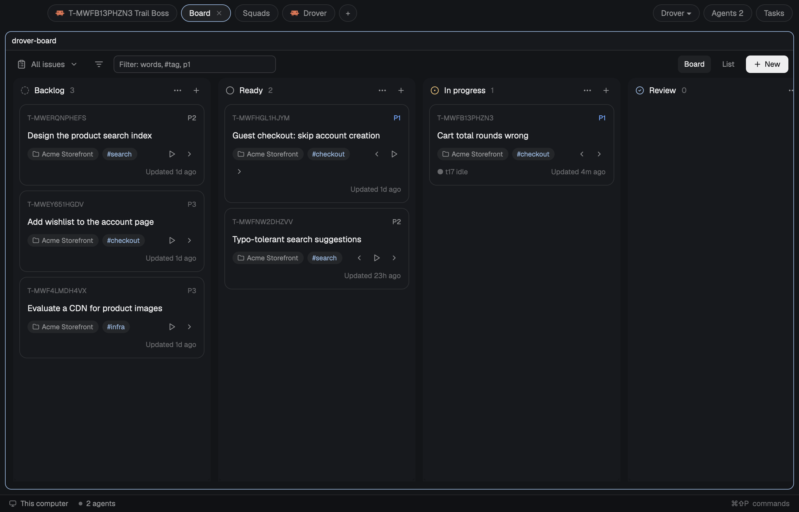

# Board

A Trello-like board of all tasks, one column per status, with drag and drop and one-click agent start.

## What you see

A tab with a header and six columns side by side: Backlog, Ready, In progress, Review, Blocked, Done, each with an icon, name, count, a `…` menu and a `+`. Header, left to right: a scope menu (`All issues`, With agent, No agent, P0-P1), a filter button, a text box (`Filter: words, #tag, p1`), a `Board | List` switch and a white `+ New` button.
A card is rounded and bordered: id and priority on the top row (P1 blue), the title, a footer with a project chip (`Acme Storefront`), `#tag` chips and small icon buttons (‹ move left, ▶ start, › move right, ↗ open the linked issue), and `Updated 2d ago`. A card with an agent shows its assignee and live status ("Stray Roundup · t3q done"). List view shows the same cards in one scrolling list.

## How it behaves

- Drag a card up or down to sort, onto another column to move it; ‹ › move it one column; a click edits it (the Todos dialog); ▶ opens the Start picker.
- Keys (click the board first): arrows select, shift+←/→ move, enter edit, `n` new, `s` start.
- A column `…` menu sorts (Manual, Priority, Newest), collapses it, and on Done offers an archive with a Confirm / Cancel row.
- A column hidden in Drover Config (`drover-board.visible_columns`) is hidden on screen only; the header counts the cards it keeps out of sight.
- A new card goes to Ready, or to the first visible column when Ready is hidden.

## Built from

- Mod `drover-board`, `place: none`, `focusable: true`, `main.js` (about 330 lines) and `icons/`.
- `herdr` imports: `agents`, `terminals`, `theme`, `shared`. Card status comes from `attention()` in `_lib/store.js` joined with the live agents.
- It applies the `drover` CLI inbox (`<home>/data/drover-inbox`) even when its screen is off.

## Watch out

- Shared state keys are named in `_lib/store.js` (`drover.tasks`, `drover.projects`), `_lib/wake.js` (`drover.wakeups`) and `_lib/runs.js` (`drover.agents`, `drover.runs`). `mods/install.sh` copies the `_lib` files listed in `_lib/copies.txt` next to `main.js`; a copy of the mod alone must carry them.
- Hard dependencies: `drover-todos` (editor and New dialog) and `drover-agents` (the ▶ picker). Without them those buttons open nothing.
- The CLI inbox is applied by whichever of Tasks, Board or Wakeups is open; with none open `drover move` stays queued.
- Hiding a column never changes data: the CLI and other screens still see all six.
- Colors, borders and radii come from `theme()`; no hex value is hard coded. Every screen has an `enabled` switch in Drover Config (off hides the screen only; the data and the `drover` CLI stay).

## Companion mods

<!-- companions:begin -->
**Before you finish, check the companion mods.** Drover is 16 `drover-*` mods and one layout that work together. This mod is one of them.

1. List what is installed: `ls <home>/mods | grep '^drover-'` (`<home>` is the Herdr home, `~/.config/herdr-app` by default). Compare it with this list and work out which are missing:
   `drover-agents`, `drover-board`, `drover-config`, `drover-github`, `drover-jira`, `drover-needs`, `drover-newtask`, `drover-projects`, `drover-reader`, `drover-room`, `drover-runs`, `drover-switch`, `drover-tabs`, `drover-tasks`, `drover-todos`, `drover-wakeups`. Also check `<home>/layouts/drover.json`.
2. Tell the person plainly: "installed X of 16, missing [...]". Count this mod as installed once it is in place. If this is the only one, say so.
3. If any are missing, recommend installing all of them: clone `github.com/MathieuDoyon/drover`, then run `mods/install.sh` (it also links the `drover` layout). Or install them one by one from herdr.dev. Ask before installing anything.
4. Then ask once, in one message: Work folder location (project default or the repo's `.drover/`); enable GitHub (y/n); enable Jira (y/n); a shortcut for the right sidebar (Tasks) (y/n); a shortcut to create a task (y/n). Apply the answers in Drover Config (Work folder, the GitHub and Jira switches). The two shortcuts go into `keys.json` under `layout:drover` (`cmd-alt-b` runs `layout.toggle` for the `drover` column) and `global` (`cmd-shift-c` runs `mod.open:drover-newtask`); Drover Config → Shortcuts writes them. Ask before replacing a key the person already uses.
<!-- companions:end -->

## Done when

- Six columns with the right counts; dragging a card to Review shows it in Review in Todos too.
- ▶ on a Ready card opens the picker; shift+→ on a selected card moves it one column.
- Hiding `Done` in Drover Config removes the column and the header shows the hidden count.
- `herdr-app check` on the mod passes.
