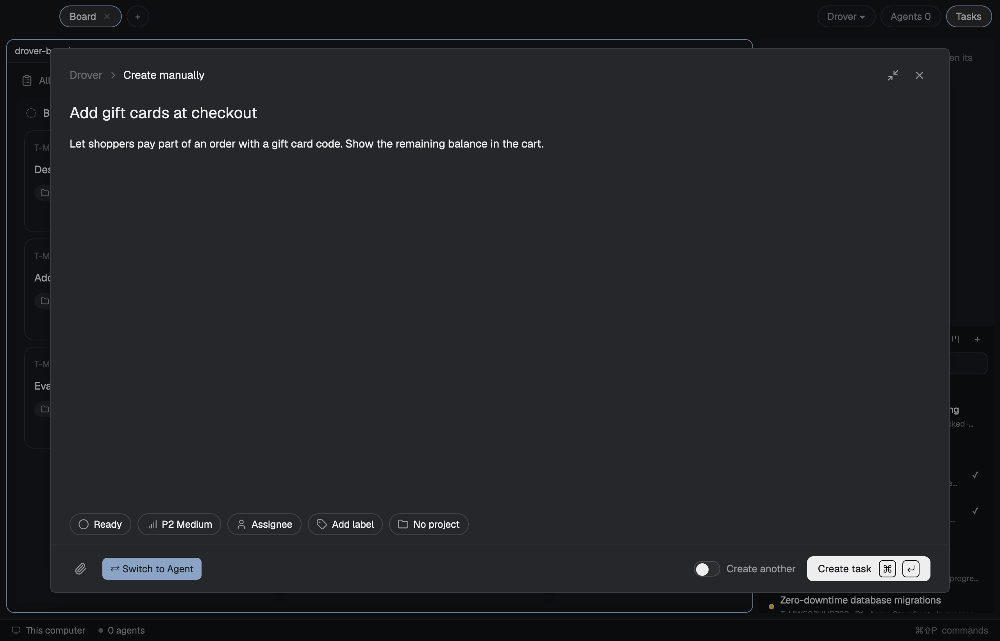

# New task

A no-UI mod bound to one key: press it anywhere and the Create task dialog opens.

## What you see

Nothing is drawn: it opens the Create dialog of `drover-todos` and closes its own empty 8x8 overlay.

## How it behaves

- Bound in `keys.json` as `"cmd-shift-c": "mod.open:drover-newtask"` (section `global`).
- It opens no second dialog while one Create dialog is open (a guard in shared state, `drover.newtask.open`, kept alive by a heartbeat).
- Turned on and off from Drover Config → Shortcuts.

## Built from

- Mod `drover-newtask`, `place: none`, `mod.json`: `{ "place": "none", "title": "New task", "overlay": { "width": 8, "height": 8 } }`, `main.js` (26 lines) plus the shared `io.js`, `store.js` and the other shared copies.
- `herdr` imports: `props`, `closeOverlay`, `shared`. A `View` whose `init` reads `props()?.overlay` (null when the host only checks the mod: then do nothing); in a `try`, if `!guardLive(shared("drover.newtask.open"))` it calls `reserveCreate()` then `edit(null, "todo")`; in `finally` it always `closeOverlay(overlay)`. `render` returns an empty `div()`. Nothing is awaited between the check and the reservation, so two presses cannot both pass.
- **The shared guard** (shared key `drover.newtask.open`, defined in `io.js`, read by `drover-todos`). It is one of: `{ "id": <overlay id>, "at": <ms> }` (a Create dialog is open), `{ "pending": true, "at": <ms> }` (a key press reserving its slot), an older plain id string, or `null`. A guard is live when `pending` and `now - at < 3000` (`PENDING_MS`), or when it has an `id` and `now - at < 40000` (`LIVE_MS`); an older plain string counts as `at: 0` (never live). `reserveCreate()` writes `{ pending: true, at: Date.now() }`.
- **The dialog.** `edit(null, "todo")` opens `openOverlay({ mod: "drover-todos", kind: "dialog", modal: true, width: 720, height: 520, props: { edit: null, column: "todo" } })` (large: `width: 0.9, height: 0.85`, props also carry `large: true` and the `draft`), and for a create (id null) immediately writes the guard `{ id: <the returned overlay id>, at: Date.now() }`.
- **How Todos keeps it alive.** In `drover-todos`' View init, when `props().edit == null` (a Create dialog) it remembers its own overlay id, starts a timer every `HEARTBEAT_MS = 15000` calling `beatCreateGuard(overlay)`, and on close calls `clearCreateGuard(overlay)`. `beatCreateGuard` rewrites the guard to `{ id: overlay, at: now }` when the guard's id is this overlay or the guard is not live (so an older dialog re-protects the key within one beat after a newer one closed); it never overwrites a different live id. `clearCreateGuard(overlay)` sets the guard to `null` only if the guard's id is that overlay, so an old dialog closing after an expand/shrink reopen leaves the new record alone. A crash stops the heartbeat, so the guard lapses after 40 seconds.
- Key binding (from `drover-config` Shortcuts): section `global`, `"cmd-shift-c": "mod.open:drover-newtask"`.

## Watch out

- Shared state keys are named in `_lib/store.js` (`drover.tasks`, `drover.projects`), `_lib/wake.js` (`drover.wakeups`) and `_lib/runs.js` (`drover.agents`, `drover.runs`). `mods/install.sh` copies the `_lib` files listed in `_lib/copies.txt` next to `main.js`; a copy of the mod alone must carry them.
- Hard dependency: `drover-todos`, the dialog this opens. Without it the key does nothing.
- The key is not bound until `keys.json` has it. Never replace a key the person already uses: tell them to free it first.
- Colors, borders and radii come from `theme()`; no hex value is hard coded. Every screen has an `enabled` switch in Drover Config (off hides the screen only; the data and the `drover` CLI stay).

## Companion mods

<!-- companions:begin -->
**Before you finish, check the companion mods.** Drover is 17 `drover-*` mods and one layout that work together. This mod is one of them.

1. List what is installed: `ls <home>/mods | grep '^drover-'` (`<home>` is the Herdr home, `~/.config/herdr-app` by default). Compare it with this list and work out which are missing:
   `drover-agents`, `drover-board`, `drover-config`, `drover-github`, `drover-jira`, `drover-jump`, `drover-needs`, `drover-newtask`, `drover-projects`, `drover-reader`, `drover-room`, `drover-runs`, `drover-switch`, `drover-tabs`, `drover-tasks`, `drover-todos`, `drover-wakeups`. Also check `<home>/layouts/drover.json`.
2. Tell the person plainly: "installed X of 17, missing [...]". Count this mod as installed once it is in place. If this is the only one, say so.
3. If any are missing, recommend installing all of them: clone `github.com/MathieuDoyon/drover`, then run `mods/install.sh` (it also links the `drover` layout). Or install them one by one from herdr.dev. Ask before installing anything.
4. Then ask once, in one message: Work folder location (project default or the repo's `.drover/`); enable GitHub (y/n); enable Jira (y/n); a shortcut for the right sidebar (Tasks) (y/n); a shortcut to create a task (y/n). Apply the answers in Drover Config (Work folder, the GitHub and Jira switches). The two shortcuts go into `keys.json` under `layout:drover` (`cmd-alt-b` runs `layout.toggle` for the `drover` column) and `global` (`cmd-shift-c` runs `mod.open:drover-newtask`); Drover Config → Shortcuts writes them. Ask before replacing a key the person already uses.
<!-- companions:end -->

## Done when

- Pressing the key opens the Create dialog; pressing it again does not stack another.
- `herdr-app check` on the mod passes.
