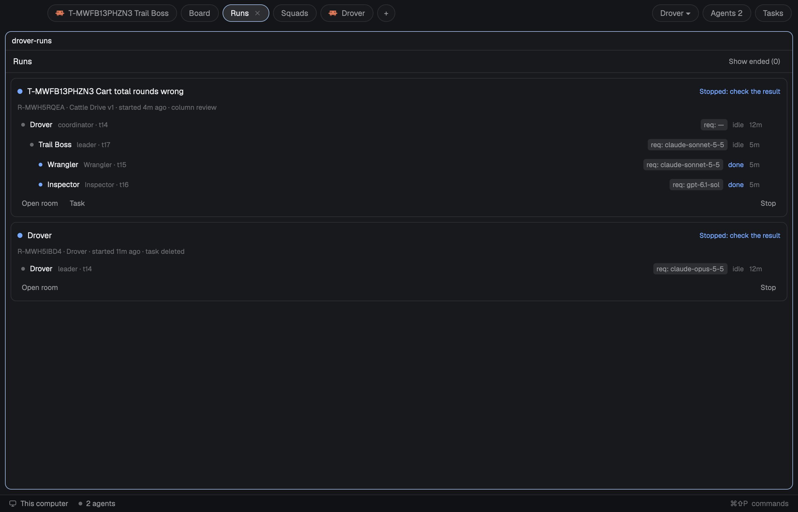

# Runs

Every agent or squad run, with each member's live status and the buttons to open, stop or forget it.

## What you see

A tab with one block per run, newest first: the run title (task or agent), its status (running, ended, stopped), its members (role, terminal address like `t3q`, live status working / blocked / done / stopped) and the links `Open room`, `Focus`, `Stop` and `Forget` (ended runs only). Colors follow the agent status dots.

## How it behaves

- `Open room` opens the run's worktree space or tab; `Focus` focuses a member.
- `Stop` takes 2 clicks (a confirm), then kills the run's terminals. Worktrees are never removed.
- A stopped agent shows "stopped: check the result", never "done": only the person or `drover move` sends a card to Review.
- `Forget` drops an ended run from `drover.runs`.
- At most `drover-runs.max_parallel` runs go at once (default 2); `kept` caps the ended runs it keeps.

## Built from

- Mod `drover-runs`, `place: none`, `main.js` (about 90 lines).
- `herdr` imports: `agents`, `terminals`, `run`, `theme`, `setShared`, `shared`. Uses `runStatus`, `liveStatuses`, `lineageOf`, `squadRows`, `stopTargets`, `openCommand` from `_lib/runs.js`.
- Calls `observeEnded` in `_lib/io.js`, which can kill parked workers of an ended run.

## Watch out

- Shared state keys are named in `_lib/store.js` (`drover.tasks`, `drover.projects`), `_lib/wake.js` (`drover.wakeups`) and `_lib/runs.js` (`drover.agents`, `drover.runs`). `mods/install.sh` copies the `_lib` files listed in `_lib/copies.txt` next to `main.js`; a copy of the mod alone must carry them.
- Runs only exist once something started them (`drover-agents` ▶, Board or Tasks). The empty list on a fresh install is normal; the screen has no create button.
- Stop kills terminals: never test it against the person's real terminals.
- Colors, borders and radii come from `theme()`; no hex value is hard coded. Every screen has an `enabled` switch in Drover Config (off hides the screen only; the data and the `drover` CLI stay).

## Companion mods

<!-- companions:begin -->
**Before you finish, check the companion mods.** Drover is 17 `drover-*` mods and one layout that work together. This mod is one of them.

1. List what is installed: `ls <home>/mods | grep '^drover-'` (`<home>` is the Herdr home, `~/.config/herdr-app` by default). Compare it with this list and work out which are missing:
   `drover-agents`, `drover-board`, `drover-config`, `drover-github`, `drover-jira`, `drover-jump`, `drover-needs`, `drover-newtask`, `drover-projects`, `drover-reader`, `drover-room`, `drover-runs`, `drover-switch`, `drover-tabs`, `drover-tasks`, `drover-todos`, `drover-wakeups`. Also check `<home>/layouts/drover.json`.
2. Tell the person plainly: "installed X of 17, missing [...]". Count this mod as installed once it is in place. If this is the only one, say so.
3. If any are missing, recommend installing all of them: clone `github.com/MathieuDoyon/drover`, then run `mods/install.sh` (it also links the `drover` layout). Or install them one by one from herdr.dev. Ask before installing anything.
4. Then ask once, in one message: Work folder location (project default or the repo's `.drover/`); enable GitHub (y/n); enable Jira (y/n); a shortcut for the right sidebar (Tasks) (y/n); a shortcut to create a task (y/n). Apply the answers in Drover Config (Work folder, the GitHub and Jira switches). The two shortcuts go into `keys.json` under `layout:drover` (`cmd-alt-b` runs `layout.toggle` for the `drover` column) and `global` (`cmd-shift-c` runs `mod.open:drover-newtask`); Drover Config → Shortcuts writes them. Ask before replacing a key the person already uses.
<!-- companions:end -->

## Done when

- After a ▶ start the run appears with its members.
- Stop asks twice before killing; Forget removes only an ended run.
- `herdr-app check` on the mod passes.
- A run that was resumed carries `resumedBy`; the orphan reaper skips it (the new run has its own new terminals). An ended run offers **Resume squad** when `canResume`; one click = one `resumeSquad` call; **Cancel resume** while an attempt runs; a crashed attempt shows **Resume needs recovery** with Recover and Cancel (manual only; `observeEnded` never touches an attempt).
