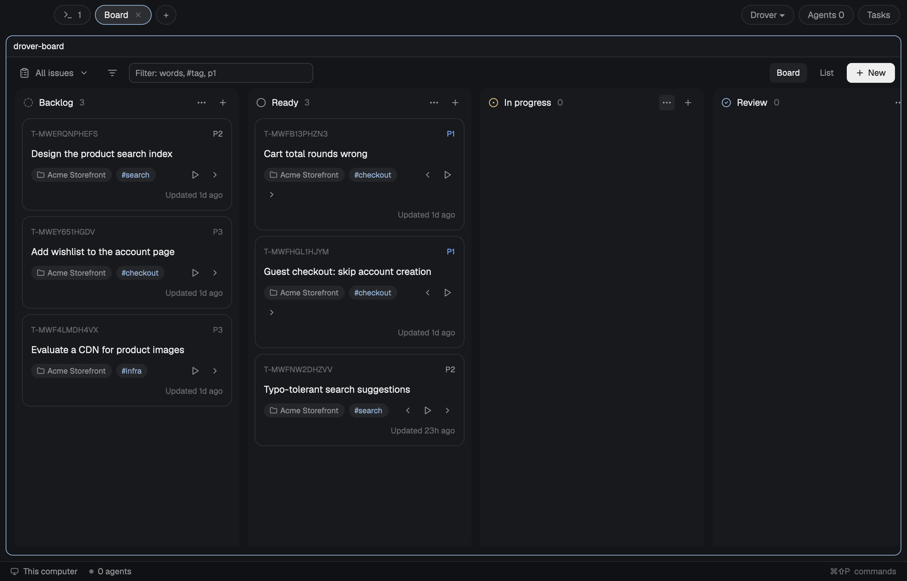

# Drover Tabs

The tab bar of the `drover` layout: capsule tabs with agent status, an agent selector, the `Drover` screens menu and the Tasks toggle.

## What you see

A 42px bar. Left: round capsule tabs (the first shows a terminal glyph and a number) and a `+` capsule. Right: `Drover ▾`, `Agents 5 ● 1` (a count plus a dot per status, blocked and working) and `Tasks`. The active tab is highlighted; a tab with an agent shows a spinner (working), a needs-you mark (blocked) or a done mark.

## How it behaves

- `Drover ▾` (a 280x530 popup) opens a screen as a tab (a screen already in a tab is selected instead) or splits the current pane (`Split →`, `↓`). It also offers 3 two-screen tabs: Sources (Jira | GitHub), Squads (Agents | Runs), Work (Board | Tasks), and Settings → Config.
- A screen is offered only when its `enabled` is on.
- `Agents N` opens a list of every agent; a click goes to it (a parked worker opens in a modal).
- `Tasks` (or `cmd-alt-b` under `layout:drover`) toggles the layout's `drover` column; a right click on a tab opens the Herdr tab menu; `+` opens the shipped `new-menu`.

## Built from

- Mod `drover-tabs`, `place: none`, `main.js` (about 160 lines). Based on the shipped tabs mod.
- `herdr` imports: `spaces`, `panes`, `agents`, `run`, `openOverlay`, `closeOverlay`, `props`, `theme`, `window`, `layout`, `settings`, `shared`.
- Herdr commands: `tab.new`, `tab.select`, `pane.split`, `tab.rename`, `layout.toggle`.
- Screens in the menu: Todos, Board, Jira, GitHub, Squads (`drover-agents`), Runs, Wakeups, Projects, Reader.

## Watch out

- Shared state keys are named in `_lib/store.js` (`drover.tasks`, `drover.projects`), `_lib/wake.js` (`drover.wakeups`) and `_lib/runs.js` (`drover.agents`, `drover.runs`). `mods/install.sh` copies the `_lib` files listed in `_lib/copies.txt` next to `main.js`; a copy of the mod alone must carry them.
- Only useful in the `drover` layout (it expects a `drover` column to toggle).
- It opens the shipped `menu` and `new-menu` mods: they ship with Herdr and must exist in the Herdr home.
- It opens every other Drover screen by name; a missing mod's entry opens an empty tab.
- Colors, borders and radii come from `theme()`; no hex value is hard coded. Every screen has an `enabled` switch in Drover Config (off hides the screen only; the data and the `drover` CLI stay).

## Companion mods

<!-- companions:begin -->
**Before you finish, check the companion mods.** Drover is 14 `drover-*` mods and one layout that work together. This mod is one of them.

1. List what is installed: `ls <home>/mods | grep '^drover-'` (`<home>` is the Herdr home, `~/.config/herdr-app` by default). Compare it with this list and work out which are missing:
   `drover-agents`, `drover-board`, `drover-config`, `drover-github`, `drover-jira`, `drover-newtask`, `drover-projects`, `drover-reader`, `drover-room`, `drover-runs`, `drover-tabs`, `drover-tasks`, `drover-todos`, `drover-wakeups`. Also check `<home>/layouts/drover.json`.
2. Tell the person plainly: "installed X of 14, missing [...]". Count this mod as installed once it is in place. If this is the only one, say so.
3. If any are missing, recommend installing all of them: clone `github.com/MathieuDoyon/drover`, then run `mods/install.sh` (it also links the `drover` layout). Or install them one by one from herdr.dev. Ask before installing anything.
4. Then ask once, in one message: Work folder location (project default or the repo's `.drover/`); enable GitHub (y/n); enable Jira (y/n); a shortcut for the right sidebar (Tasks) (y/n); a shortcut to create a task (y/n). Apply the answers in Drover Config (Work folder, the GitHub and Jira switches). The two shortcuts go into `keys.json` under `layout:drover` (`cmd-alt-b` runs `layout.toggle` for the `drover` column) and `global` (`cmd-shift-c` runs `mod.open:drover-newtask`); Drover Config → Shortcuts writes them. Ask before replacing a key the person already uses.
<!-- companions:end -->

## Done when

- The `Drover ▾` menu lists the installed screens.
- `Tasks` hides and shows the right column.
- A blocked agent shows on the `Agents` dot and on the tab's mark.
- `herdr-app check` on the mod passes.
