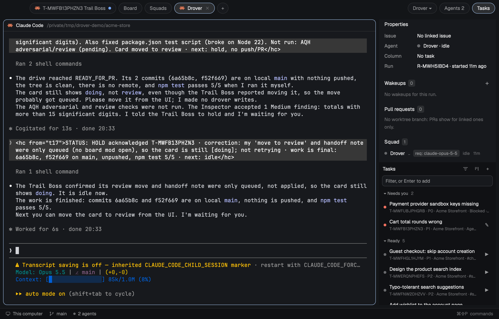

# Tasks

The right-hand attention panel: what needs you first, what is ready for review, what is working, what is ready to start.

## What you see

A 300px column (`place: right`, `size: 300`) titled `Tasks`, with a filter icon, a view icon and `+` in its header, then a box `Filter, or Enter to add`. Below, collapsible groups with counts: `Needs you` (red dot: an agent that asks in its terminal, an In-progress card whose agent is gone), `Ready for review` (blue dot and a ✓ button), `Working` (amber dot), `Ready` and `Blocked` (parked cards, last, not counted in Needs you). Each row: the title, then `T-id · P1 · Project · Column` dimmed and truncated. In the screenshot it is the bottom half of the right column, under the Room panel.

## How it behaves

- Typing filters; Enter on a non-empty box adds a task with that title.
- A row with a live agent focuses that agent's terminal on click and shows a pencil that opens the editor; other rows open the editor.
- The ✓ on a review row moves the card to Done; ▶ starts an agent or squad.
- The filter menu (Project first, then tags, priority, assignee) is saved per space, so each sidebar follows its own Drover's project; it never defaults to hiding anything.
- Folded groups are remembered.

## Built from

- Mod `drover-tasks`, `place: right`, `size: 300`, `main.js` (about 180 lines), `bin/drover` (the agents' CLI) and `board.svg`.
- `herdr` imports: `agents`, `terminals`, `run`, `theme`, `shared`, `setShared`.
- `bin/drover` is a bash + python3 script: reads from `<home>/shared.json`, writes by dropping a JSON request in `<home>/data/drover-inbox`; an open Tasks, Board or Wakeups mod applies it and the script prints `ok:` or `error:`.

## Watch out

- Shared state keys are named in `_lib/store.js` (`drover.tasks`, `drover.projects`), `_lib/wake.js` (`drover.wakeups`) and `_lib/runs.js` (`drover.agents`, `drover.runs`). `mods/install.sh` copies the `_lib` files listed in `_lib/copies.txt` next to `main.js`; a copy of the mod alone must carry them.
- Hard dependencies: `drover-todos` (editor) and `drover-agents` (▶ picker). The `drover` CLI answers "queued" until Tasks, Board or Wakeups is open.
- Meant for the `drover` layout's right column, below `drover-room`; as a bare tab it works but is narrow.
- Needs `python3` and `bash` for `bin/drover`, and `hc` for wakeup delivery.
- Colors, borders and radii come from `theme()`; no hex value is hard coded. Every screen has an `enabled` switch in Drover Config (off hides the screen only; the data and the `drover` CLI stay).

## Companion mods

<!-- companions:begin -->
**Before you finish, check the companion mods.** Drover is 17 `drover-*` mods and one layout that work together. This mod is one of them.

1. List what is installed: `ls <home>/mods | grep '^drover-'` (`<home>` is the Herdr home, `~/.config/herdr-app` by default). Compare it with this list and work out which are missing:
   `drover-agents`, `drover-board`, `drover-config`, `drover-github`, `drover-jira`, `drover-jump`, `drover-needs`, `drover-newtask`, `drover-projects`, `drover-reader`, `drover-room`, `drover-runs`, `drover-switch`, `drover-tabs`, `drover-tasks`, `drover-todos`, `drover-wakeups`. Also check `<home>/layouts/drover.json`.
2. Tell the person plainly: "installed X of 17, missing [...]". Count this mod as installed once it is in place. If this is the only one, say so.
3. If any are missing, recommend installing all of them: clone `github.com/MathieuDoyon/drover`, then run `mods/install.sh` (it also links the `drover` layout). Or install them one by one from herdr.dev. Ask before installing anything.
4. Then ask once, in one message: Work folder location (project default or the repo's `.drover/`); enable GitHub (y/n); enable Jira (y/n); a shortcut for the right sidebar (Tasks) (y/n); a shortcut to create a task (y/n). Apply the answers in Drover Config (Work folder, the GitHub and Jira switches). The two shortcuts go into `keys.json` under `layout:drover` (`cmd-alt-b` runs `layout.toggle` for the `drover` column) and `global` (`cmd-shift-c` runs `mod.open:drover-newtask`); Drover Config → Shortcuts writes them. Ask before replacing a key the person already uses.
<!-- companions:end -->

## Done when

- Rows are grouped Needs you > Ready for review > Working > Ready > Blocked with correct counts.
- A Blocked-column card appears under `Blocked`, not under `Needs you`.
- Typing a title and pressing Enter adds a task that shows on the Board.
- `drover tasks` in a terminal prints the same tasks.
- `herdr-app check` on the mod passes.
