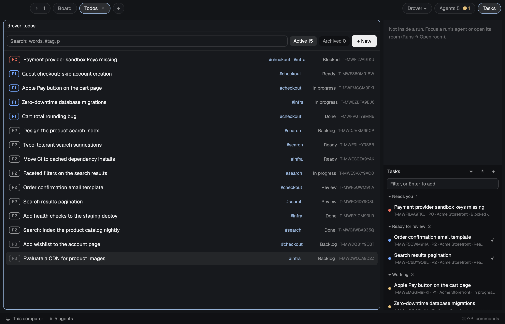

# Todos

The full task list: a search box, one row per task, and the dialog every other Drover screen opens to create or edit a task.

## What you see

A tab (or split pane) with a toolbar and a list. Toolbar, left to right: a search box (`Search: words, #tag, p1`), the toggles `Active N` and `Archived N`, and a white `+ New` button. Below it, one row per task sorted by priority: a priority badge (P0 red outline, P1 blue, P2/P3 grey), the title, its `#tags` in blue, the column name (Blocked, Ready, In progress, Review, Backlog, Done) and the id (`T-…`). The hovered row has a raised background.
The editor is a modal dialog (720x520, or 0.9x0.85 when expanded) opened by `+ New` or a row click: title, description (Markdown; checklists show progress), priority, column, tags, project, parent, assignee (agent or squad), a Source section (linked Jira or GitHub issue, Link / Unlink), notes, and the task's run history.

## How it behaves

- Typing in the search box filters live; `words`, `#tag` and `p1` combine.
- `Active` / `Archived` switch the list.
- A row click opens the editor in the same mod (`props.edit` = the task id); `+ New` opens it empty (`props.edit` null). Create and edit share one shell; an expand button reopens it large and keeps the draft.
- Saving writes the whole `drover.tasks` array through `store.js` (`add`, `update`, `saveText`). An empty title or one over 200 characters shows the error and saves nothing.
- A guard in shared state (`drover.newtask.open`) stops a second Create dialog from stacking.

## Built from

- Mod `drover-todos`, `place: none`, `main.js` (about 1200 lines), the shared `_lib` copies and an `icons/` folder of lucide line SVGs.
- `herdr` imports: `props`, `closeOverlay`, `theme`, `appHome`, `exec`, `notify`, `shared`, `setShared`, `agents`, `terminals`, `run`.
- It runs `osascript` (macOS only) to paste an image from the clipboard; images are saved under the app home and referenced in the description as ``.
- Open: `herdr-app do tab.new --name Todos --mod drover-todos`.

## Watch out

- Shared state keys are named in `_lib/store.js` (`drover.tasks`, `drover.projects`), `_lib/wake.js` (`drover.wakeups`) and `_lib/runs.js` (`drover.agents`, `drover.runs`). `mods/install.sh` copies the `_lib` files listed in `_lib/copies.txt` next to `main.js`; a copy of the mod alone must carry them.
- Hard dependency of others: Board, Tasks, Jira, GitHub, Room and the New task key open this mod's dialog (`openOverlay({ mod: "drover-todos", kind: "dialog" })` in `_lib/io.js`). Without `drover-todos` they cannot create or edit.
- The assignee menu reads the agents and squads `drover-agents` saves, and the project menu the projects `drover-projects` manages; both fall back to defaults or empty.
- Colors, borders and radii come from `theme()`; no hex value is hard coded. Every screen has an `enabled` switch in Drover Config (off hides the screen only; the data and the `drover` CLI stay).

## Companion mods

<!-- companions:begin -->
**Before you finish, check the companion mods.** Drover is 14 `drover-*` mods and one layout that work together. This mod is one of them.

1. List what is installed: `ls <home>/mods | grep '^drover-'` (`<home>` is the Herdr home, `~/.config/herdr-app` by default). Compare it with this list and work out which are missing:
   `drover-agents`, `drover-board`, `drover-config`, `drover-github`, `drover-jira`, `drover-newtask`, `drover-projects`, `drover-reader`, `drover-room`, `drover-runs`, `drover-tabs`, `drover-tasks`, `drover-todos`, `drover-wakeups`. Also check `<home>/layouts/drover.json`.
2. Tell the person plainly: "installed X of 14, missing [...]". Count this mod as installed once it is in place. If this is the only one, say so.
3. If any are missing, recommend installing all of them: clone `github.com/MathieuDoyon/drover`, then run `mods/install.sh` (it also links the `drover` layout). Or install them one by one from herdr.dev. Ask before installing anything.
4. Then ask once, in one message: Work folder location (project default or the repo's `.drover/`); enable GitHub (y/n); enable Jira (y/n); a shortcut for the right sidebar (Tasks) (y/n); a shortcut to create a task (y/n). Apply the answers in Drover Config (Work folder, the GitHub and Jira switches). The two shortcuts go into `keys.json` under `layout:drover` (`cmd-alt-b` runs `layout.toggle` for the `drover` column) and `global` (`cmd-shift-c` runs `mod.open:drover-newtask`); Drover Config → Shortcuts writes them. Ask before replacing a key the person already uses.
<!-- companions:end -->

## Done when

- The list shows every non-archived task and `Active N` / `Archived N` match it.
- Creating a task from `+ New` adds a row without a restart, and the same task shows on the Board.
- An empty title shows "Title is required" and saves nothing.
- `herdr-app check` on the mod passes.
