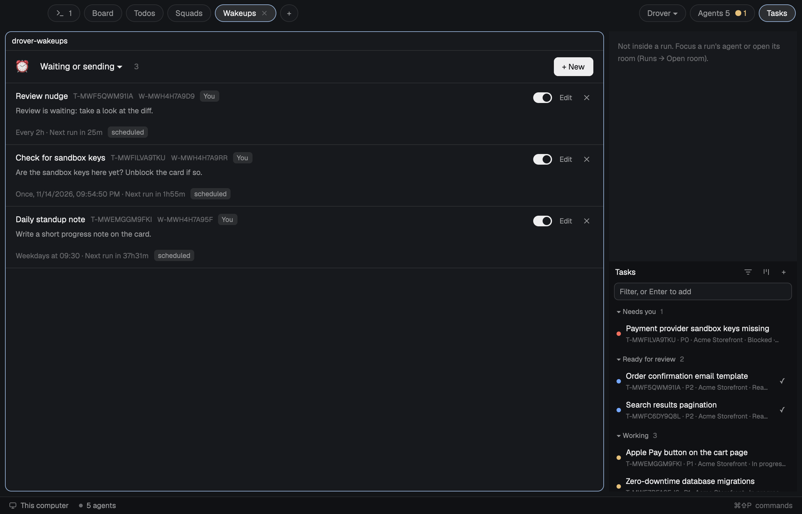

# Wakeups

A table of every scheduled message to an agent, with the controls to add, pause and edit them.

## What you see

A tab with a header (a filter `Waiting or sending` / `Ended` / `All`, and `+`) and a table: Task (or terminal), Wake agent, Source (`You` or `Agent`), When (`Weekdays at 09:30`, `Every 2h`, `Once, …`), Ends, Status, and an Enabled toggle with an edit button. Time-remaining text (`in 25m`) repaints on a timer.

## How it behaves

- `+` and a row's edit open a dialog of this same mod (`props.wakeEdit`): target (a task `T-…` or a terminal `t12`), name, message and a schedule (Once: `now`, `15m`, `1h30m`, `14:30`, `tomorrow 9:00` or a date; Repeat every 30m, 2h, 1d; or weekly days + `HH:MM`).
- Delivery uses `hc send`, and only to an idle or finished target: busy waits, blocked waits for you, gone fails, paused waits, 2h late expires (`expiry_hours`). A failed send is never retried.
- A repeat shorter than `min_repeat_minutes` (default 5) is refused.
- Agents schedule with `drover wake <t|T-…> <when> "text"`; the open Tasks panel delivers too.

## Built from

- Mod `drover-wakeups`, `place: none`, `main.js` (about 200 lines).
- `herdr` imports: `agents`, `theme`, `setShared`, `props`, `closeOverlay`, `openOverlay`, `notify`, `shared`. Logic is `_lib/wake.js` (`addWake`, `updateWake`, `decide`, `reschedule`, `wakeOp`).
- Runs `hc send` to deliver, through `_lib/io.js`.

## Watch out

- Shared state keys are named in `_lib/store.js` (`drover.tasks`, `drover.projects`), `_lib/wake.js` (`drover.wakeups`) and `_lib/runs.js` (`drover.agents`, `drover.runs`). `mods/install.sh` copies the `_lib` files listed in `_lib/copies.txt` next to `main.js`; a copy of the mod alone must carry them.
- Needs `hc`. It applies the `drover` CLI inbox (wake, wakes, wake on/off/rm) while it or Tasks or Board is open.
- A wakeup to a `T-…` task needs that task to have a live agent; otherwise it fails with "Target terminal is gone".
- Colors, borders and radii come from `theme()`; no hex value is hard coded. Every screen has an `enabled` switch in Drover Config (off hides the screen only; the data and the `drover` CLI stay).

## Companion mods

<!-- companions:begin -->
**Before you finish, check the companion mods.** Drover is 16 `drover-*` mods and one layout that work together. This mod is one of them.

1. List what is installed: `ls <home>/mods | grep '^drover-'` (`<home>` is the Herdr home, `~/.config/herdr-app` by default). Compare it with this list and work out which are missing:
   `drover-agents`, `drover-board`, `drover-config`, `drover-github`, `drover-jira`, `drover-needs`, `drover-newtask`, `drover-projects`, `drover-reader`, `drover-room`, `drover-runs`, `drover-switch`, `drover-tabs`, `drover-tasks`, `drover-todos`, `drover-wakeups`. Also check `<home>/layouts/drover.json`.
2. Tell the person plainly: "installed X of 16, missing [...]". Count this mod as installed once it is in place. If this is the only one, say so.
3. If any are missing, recommend installing all of them: clone `github.com/MathieuDoyon/drover`, then run `mods/install.sh` (it also links the `drover` layout). Or install them one by one from herdr.dev. Ask before installing anything.
4. Then ask once, in one message: Work folder location (project default or the repo's `.drover/`); enable GitHub (y/n); enable Jira (y/n); a shortcut for the right sidebar (Tasks) (y/n); a shortcut to create a task (y/n). Apply the answers in Drover Config (Work folder, the GitHub and Jira switches). The two shortcuts go into `keys.json` under `layout:drover` (`cmd-alt-b` runs `layout.toggle` for the `drover` column) and `global` (`cmd-shift-c` runs `mod.open:drover-newtask`); Drover Config → Shortcuts writes them. Ask before replacing a key the person already uses.
<!-- companions:end -->

## Done when

- Adding `now` for an idle terminal delivers once and shows the status sent.
- A repeat under the minimum shows an error under the field.
- The toggle pauses a wakeup (status `Paused`).
- `herdr-app check` on the mod passes.
